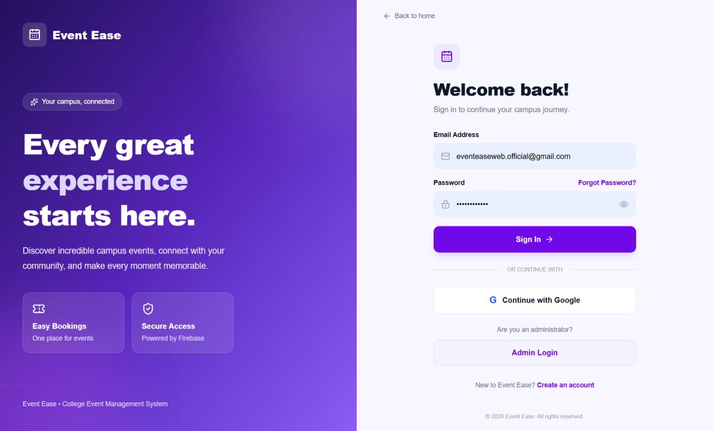
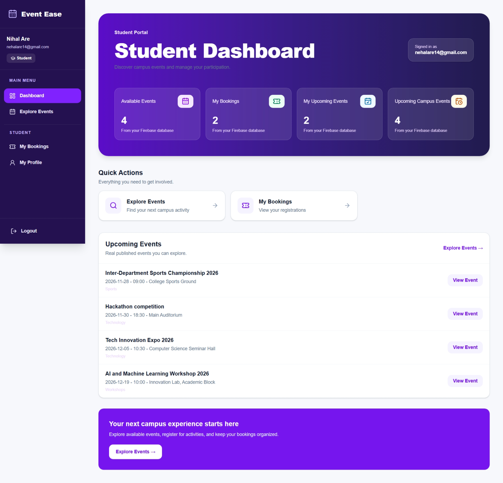
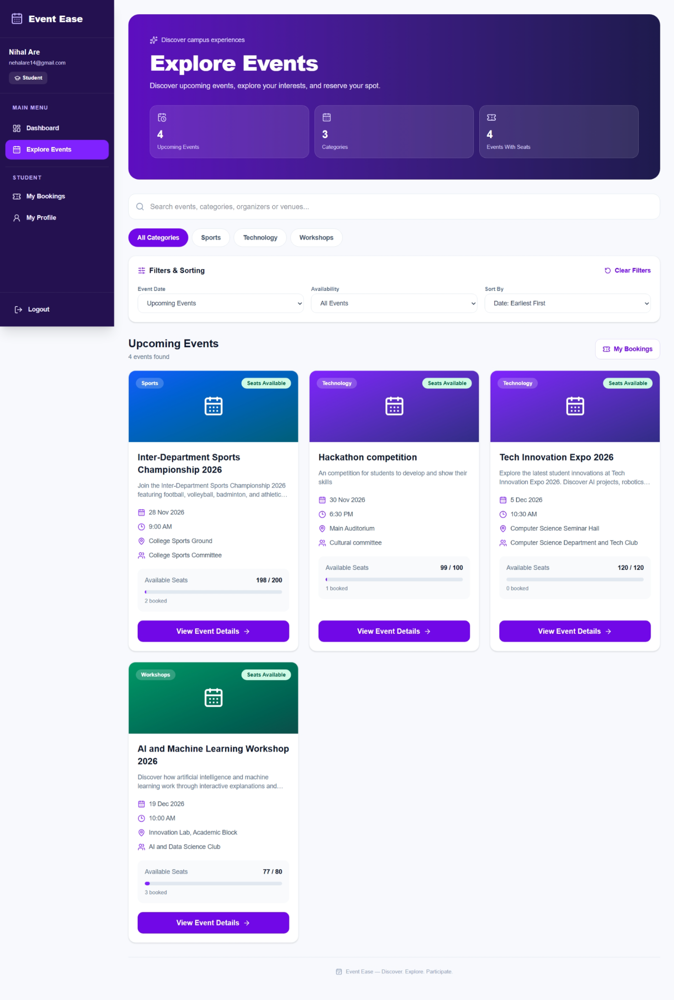
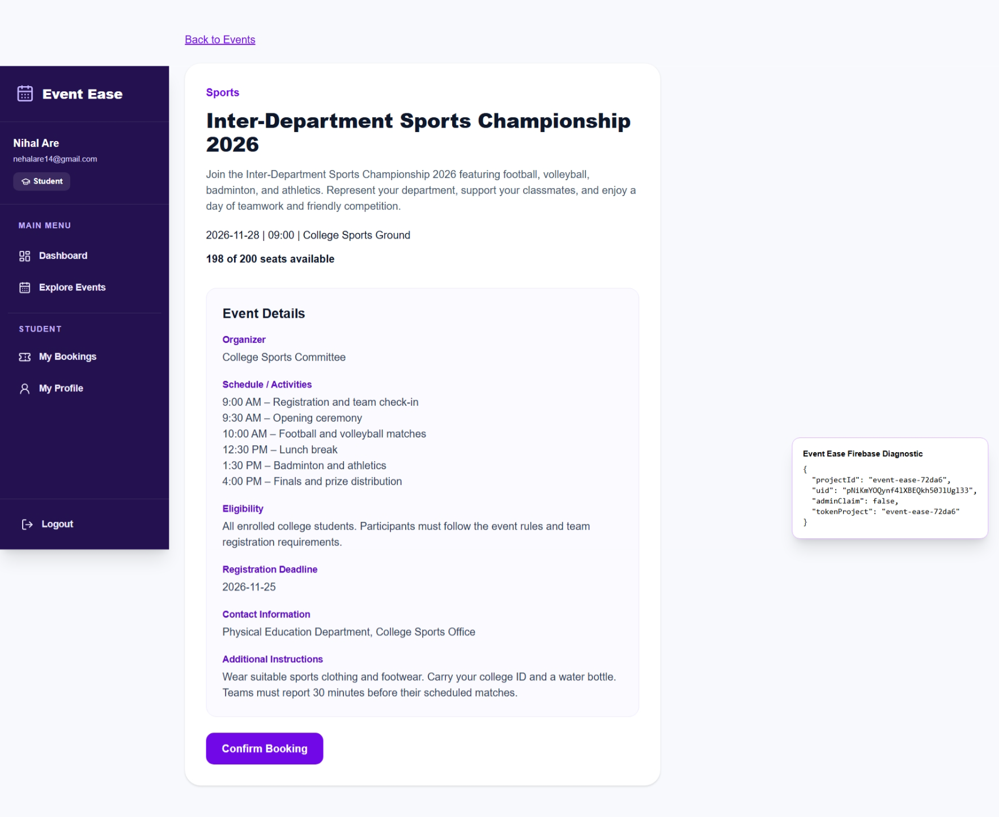
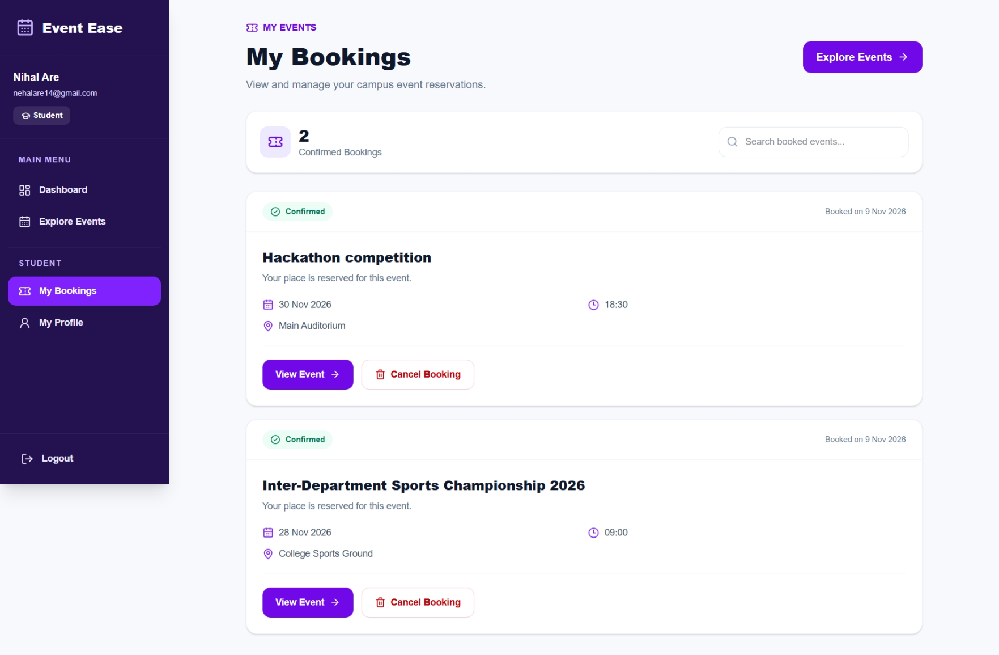
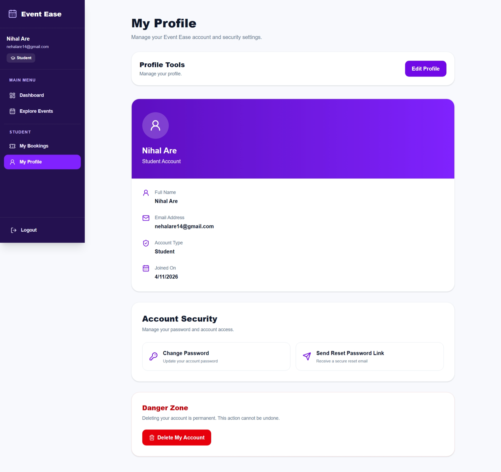
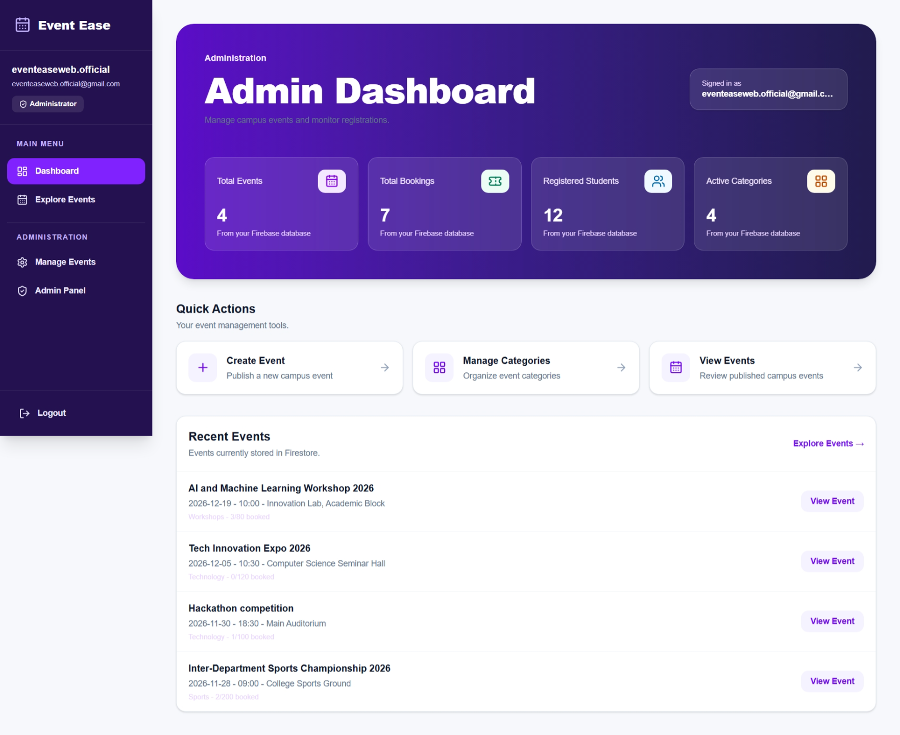
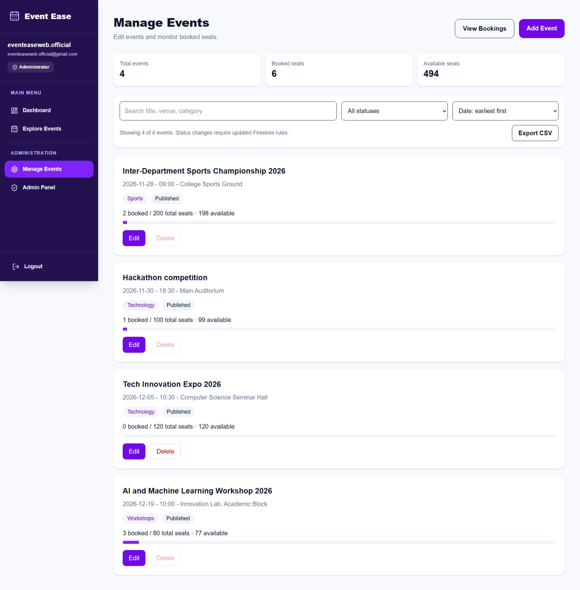

# Event Ease — College Event Management System

    

**[Live Website](https://eventease-web-sooty.vercel.app/explore-events)** · **[GitHub Repository](https://github.com/arenihal/event-ease)**

Event Ease is a college event management web application built with Next.js, React, TypeScript, and Firebase. Students can discover events, view details, register, and manage bookings. Administrators can manage events and monitor registrations.

## Features

**Student:** Explore events, search and filter by category, view event details and seat availability, book events, view or cancel bookings, and manage profile settings.

**Administrator:** Sign in to an administrator dashboard, create and manage events and categories, monitor bookings and registered students, and review event seat availability.

## Screenshots

### Student Login


### Student Dashboard


### Explore Events


### Event Details


### My Bookings


### Student Profile


### Admin Dashboard


### Manage Events


## Technology Stack

| Area | Technology |
| --- | --- |
| Frontend | Next.js, React, TypeScript |
| Authentication | Firebase Authentication |
| Database | Cloud Firestore |
| Deployment | Vercel |
| Version Control | Git and GitHub |

## Getting Started

```bash
git clone https://github.com/arenihal/event-ease.git
cd event-ease/frontend
npm install
npm run dev
```

Configure the Firebase web environment variables in `frontend/.env.local` before starting the app. Open http://localhost:3000.

## Deployment

Deploy to Vercel using `frontend` as the Root Directory, and configure the required Firebase environment variables in the Vercel project settings.

## Security

Protect privileged administrator actions using verified authorization and Firestore Security Rules. Never commit service-account credentials, private keys, or `.env.local` files.

## Project Status

Under active development.
